# Sportify · Reservas Deportivas

Sitio web de un local deportivo en Neiva para reservar canchas de **voley
playa, pádel y fútbol**, organizar **torneos por fases y cumpleaños**,
consultar o cancelar reservas con código QR y resolver dudas con un **asistente
conversacional** que también reserva y cancela.

[](https://proyecto-sportify.vercel.app)


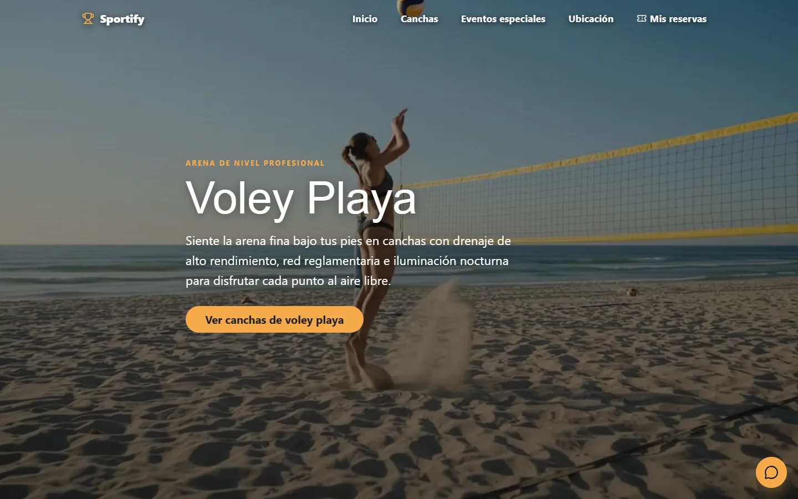

**Demo en vivo:** <https://proyecto-sportify.vercel.app>

---

## Contenido

- [Sobre el proyecto](#sobre-el-proyecto)
- [Funcionalidades](#funcionalidades)
- [Reglas del negocio](#reglas-del-negocio)
- [Arquitectura](#arquitectura)
- [Stack tecnológico](#stack-tecnológico)
- [Estructura del proyecto](#estructura-del-proyecto)
- [Instalación y uso local](#instalación-y-uso-local)
- [Pruebas](#pruebas)
- [Despliegue](#despliegue)
- [Accesibilidad y rendimiento](#accesibilidad-y-rendimiento)
- [Avance por bloques](#avance-por-bloques)
- [Créditos](#créditos)
- [Autor](#autor)

---

## Sobre el proyecto

Proyecto final de la materia **Lenguajes para la Web** (Universidad
Surcolombiana, sexto semestre). El enunciado fija estas restricciones:

| Restricción | Cómo se cumple |
|---|---|
| Frontend en React con Vite | Vite 8 con React 19, componentes funcionales y Hooks |
| Maquetación con Foundation | `foundation-sites` 6 (grid XY, botones, pestañas y utilidades) |
| Sin base de datos | Estado de React (`Context` + `useReducer`) espejado en `localStorage`, más un JSON semilla |
| Chatbot | Asistente con Gemini detrás de una función de servidor de Vercel (`/api/chat`), acotado al negocio |
| Animaciones con GSAP | GSAP + ScrollTrigger sobre la estructura de Foundation |

---

## Funcionalidades

### Un hero por deporte

Cada deporte tiene su sección a pantalla completa con un video de fondo que
avanza con el scroll: la sección queda fija (*pinning* de ScrollTrigger) y el
`currentTime` del video sigue a la rueda del mouse. Cada una tiene su color de
acento, que después usan la página de reserva y el asistente.

| Voley playa | Pádel | Fútbol |
|:---:|:---:|:---:|
|  | 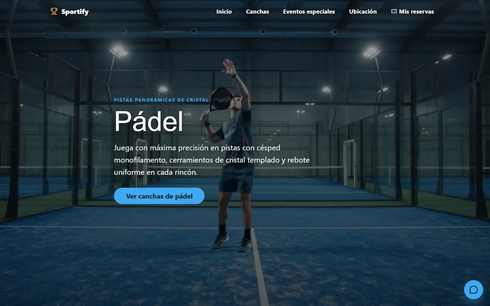 | 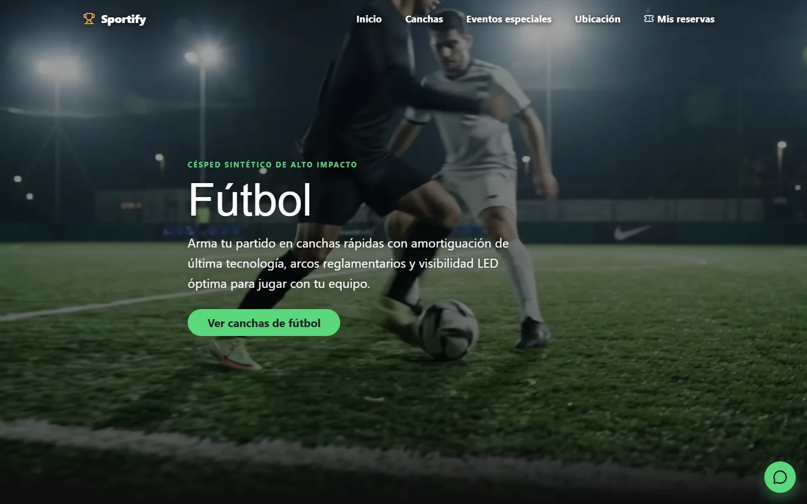 |

### Página de reserva

Todo se reserva desde una página propia del sitio (`/reservar/<deporte>`),
diseñada en **tema oscuro** igual que el inicio. Se abre desde "Ver canchas
de…" en cada hero o desde "Canchas" en el menú. Cuenta con:

- **Encabezado con foto:** franja superior con la foto de la cancha activa
  difuminada hacia el fondo oscuro y botón para volver al inicio.
- **Selector de modo con íconos:** control segmentado para alternar entre
  **Cancha**, **Torneo** y **Cumpleaños** con íconos representativos.
- **Pestañas por deporte:** con el color de acento de cada deporte en la pestaña
  activa, navegación por teclado mediante flechas y el filtro *Solo con horarios
  libres ese día*.
- **Carrusel 3D:** con las fotos de las canchas en grande, el precio, cuántos
  horarios libres tiene cada una el día elegido, las características y la
  descripción sobre la tarjeta en los tres deportes.
- **Visor en grande:** de la foto, con las características, la descripción y
  su propio botón para elegir horario (o agregar la cancha al evento).
- **Comprobante con forma de tiquete:** panel lateral que calcula el
  desglose en vivo, con perforación punteada y semicírculos decorativos.
- **URL compartible:** la página tiene su dirección (`/reservar/padel`, y
  `/reservar/padel?modo=torneo` en modo torneo), se puede abrir en otra pestaña
  y el botón "atrás" vuelve al inicio donde estabas.

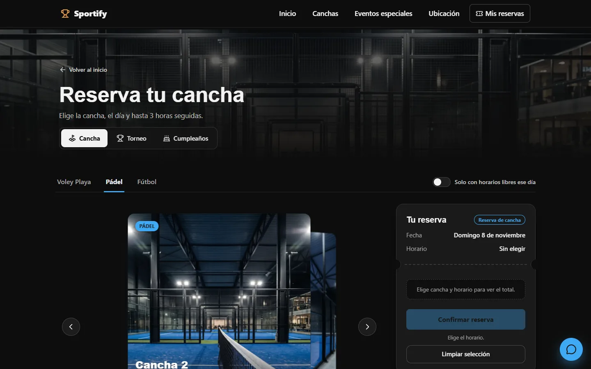

### Reserva de una cancha

Se elige el día (hoy y los 6 siguientes, cada uno con su número de horarios
libres) y de **1 a 3 horas seguidas**. Las franjas horarias se organizan en
tres grupos: **Mañana, Tarde y Noche**, acompañadas por una **leyenda** que
identifica los estados de cada botón (**Libre, Elegida y Reservada**). Desde 2
horas cada hora cuesta $5.000 menos y se regala un pack de agua. A la derecha,
el **comprobante con forma de tiquete** muestra el total en vivo y, mientras
falte algo, el motivo por el que todavía no se puede confirmar.

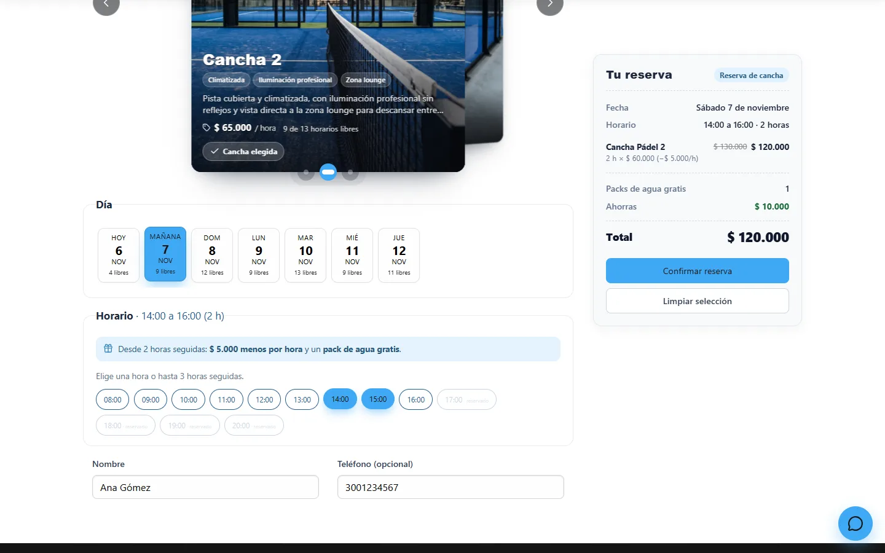

Al confirmar se muestra la pantalla de confirmación en **tema oscuro**, donde
se genera un **código de reserva** (`SPF-XXXXXX`, con botón para copiarlo en
un clic) y un **código QR sobre fondo blanco** para garantizar su lectura
óptica. El QR contiene los datos de la reserva (tipo, fecha, horario, cancha,
nombre y total) y se puede descargar para mostrarlo al llegar, junto al resumen
de las condiciones de abono y cancelación y acceso directo a **Mis reservas**.

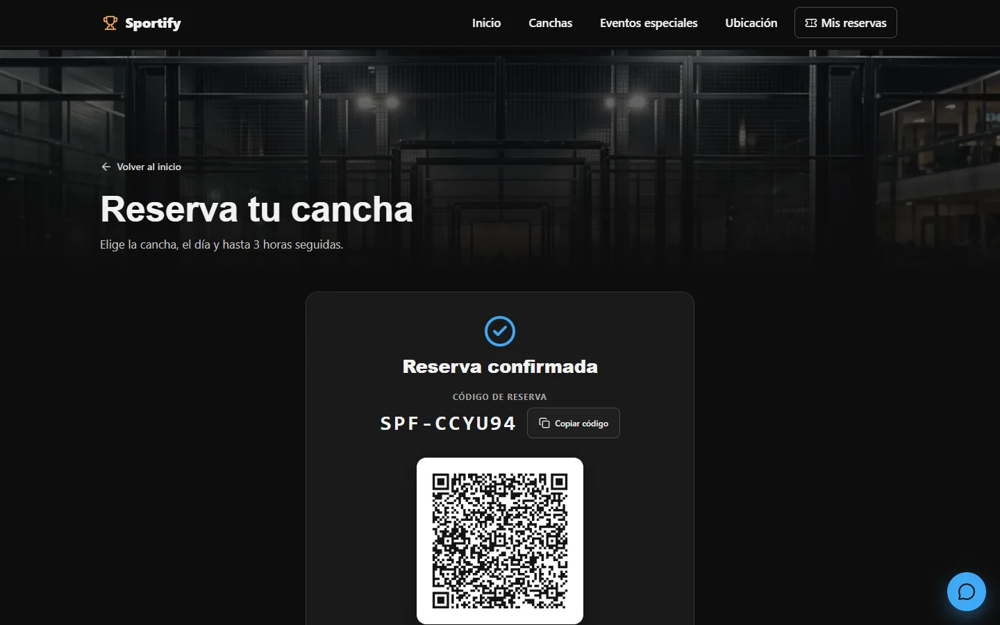

### Mis reservas

Desde el botón **Mis reservas** de la barra de navegación (o desde la pantalla
de confirmación) cualquier persona puede consultar sus reservas vigentes sin
necesidad de cuenta:

- **Búsqueda por código** (`SPF-XXXXXX`, sin importar mayúsculas o minúsculas)
  o por **nombre y teléfono** (ignora tildes y espacios).
- Permite volver a **ver el código QR** en cualquier momento y **cancelar sin
  costo** reservas individuales hasta 6 horas antes de que empiecen, liberando
  de inmediato los horarios en el calendario.

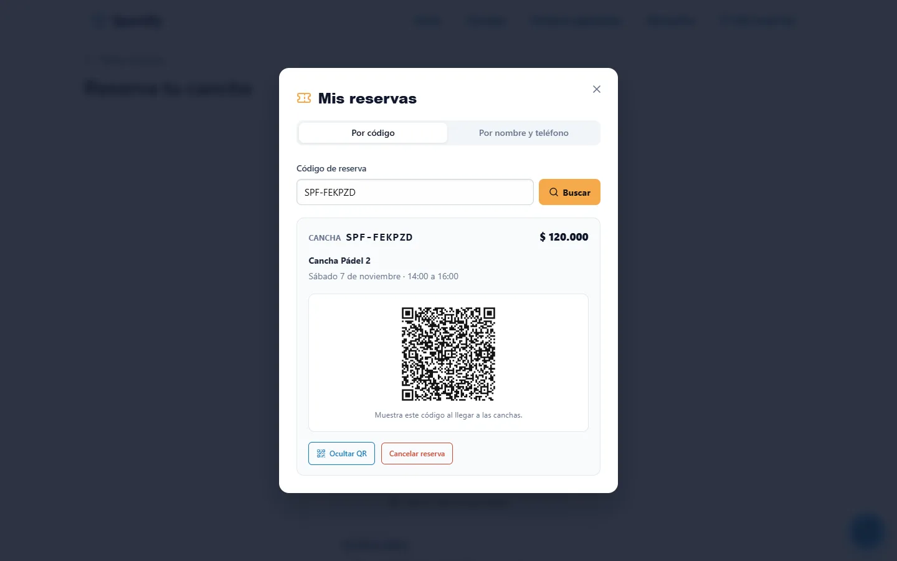

### Torneos y cumpleaños

La misma página tiene los modos **Cancha · Torneo · Cumpleaños**, adaptados a
cada tipo de reserva:

- **Torneos por fases (eliminación directa):**
  - un **indicador de pasos** superior guía el avance del torneo por cinco
    etapas (**Canchas, Formato, Fechas por fase, Llaves, Tus datos**),
    resaltando el paso actual y marcando con un visto bueno los completados.
    En el **celular** se convierte en un **asistente de un paso a la vez**
    (Canchas, Formato, Fechas por fase, Llaves, Tus datos y Resumen), con una
    barra inferior fija con **Anterior** y **Siguiente**, el motivo cuando aún
    no se puede avanzar y un indicador para saltar a los pasos ya completos o
    al primero pendiente;
  - se eligen de **1 a 3 canchas de un mismo deporte**, nunca más que los
    partidos que se juegan a la vez (con 4 equipos, hasta 2 canchas);
  - se configura el formato de **4, 8 o 16 equipos** (de 2 a 4 fases: octavos,
    cuartos, semifinal y final), la duración de cada partido (**15, 20 o 30
    min**) y el emparejamiento (**sorteo aleatorio** o **cruces manuales**
    editables en la primera ronda). El desempate depende del deporte: **penales**
    en fútbol, **tie-break** en voley playa y **super tie-break** en pádel;
  - cada fase se programa en su propio día y rango de horas dentro de la
    ventana de 7 días (en fechas crecientes o el mismo día después de cerrar la
    fase previa), con alertas si el tiempo elegido no alcanza y acción rápida
    para bajar a partidos de 15 min;
  - incluye **llaves interactivas (bracket)** a ancho completo con los partidos
    numerados como **"Partido N"** en orden de juego y la indicación de ganador
    en rondas posteriores. En **escritorio** son **simétricas con la final al
    centro y el trofeo**, mientras que en **celular** se despliegan **por rondas
    con scroll horizontal**. Las llaves también se conservan en el comprobante
    al confirmar.
- **Cumpleaños:**
  - permite combinar **varias canchas**, incluso de **distintos deportes**;
  - se elige un **rango de horas** consecutivas (inicio y fin) y la cantidad de
    **invitados** (hasta 100), que se muestra en el comprobante y en la confirmación.
- En ambos modos el bloqueo es **todo o nada** (si una sola celda cancha × hora
  está ocupada, no se reserva nada) y el precio suma cada cancha y jornada con
  las mismas reglas de descuento.

| Programación por fases del torneo | Bracket interactivo del torneo |
|:---:|:---:|
| 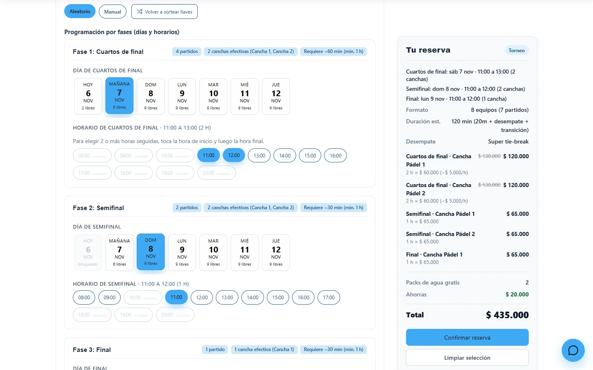 | 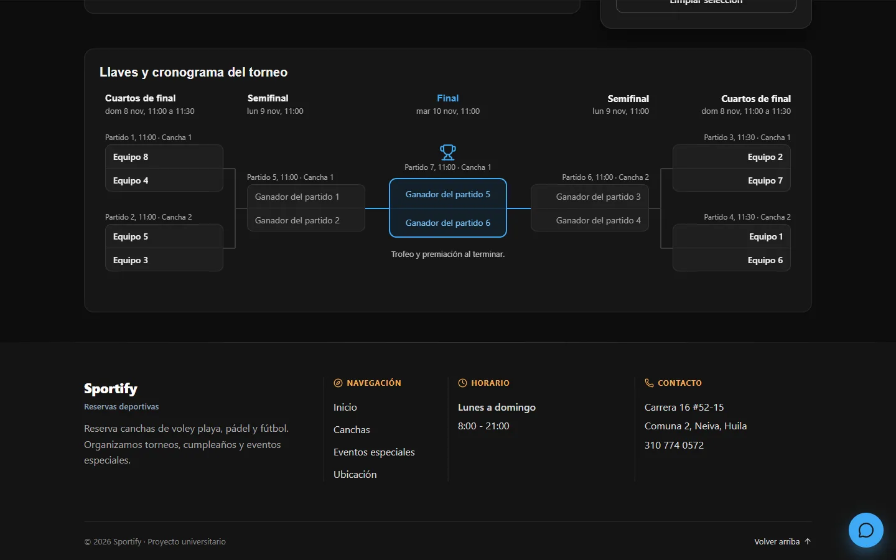 |

La sección **Eventos y torneos** de la página muestra cifras reales del local
(deportes, canchas, días y horario, con un conteo animado) y una galería por
tipo de evento.

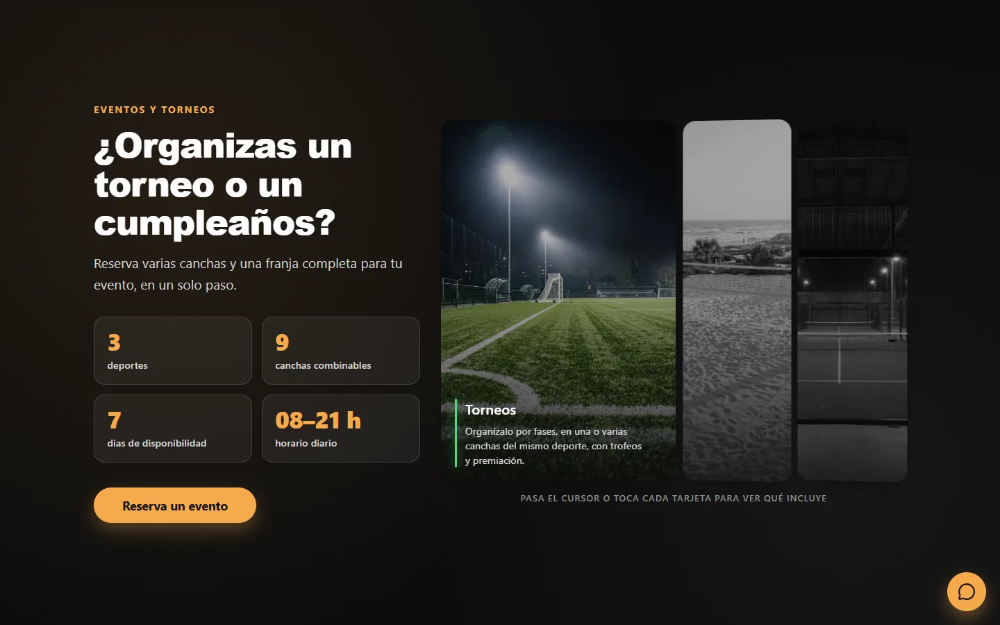

### Ubicación y contacto

La sección **Visítanos** muestra la dirección, el teléfono (con enlace para
llamar), el horario y un mapa de Google con el botón "Cómo llegar". Los datos
salen de un único archivo (`src/data/negocio.json`), así que la sección, el
footer y el asistente siempre coinciden.

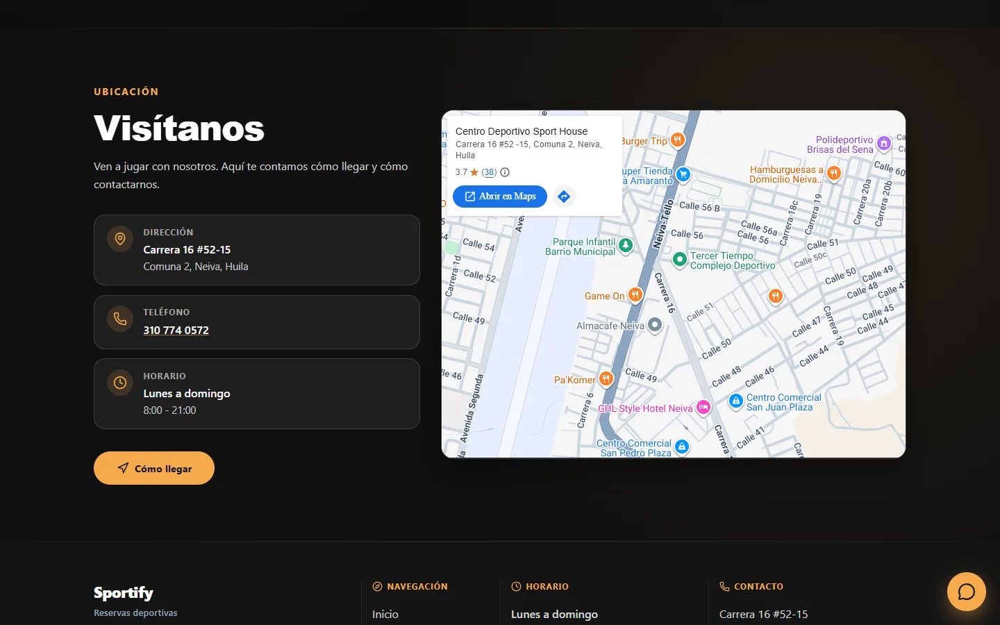

### Asistente conversacional

Un botón flotante abre el **Asistente Sportify**, disponible en todas las
páginas del sitio. Responde sobre horarios libres, precios, servicios, pagos,
política de cancelación, torneos por fases y ubicación. Cuando la respuesta lo
amerita, ofrece un botón para abrir las canchas, la reserva de eventos o la
ubicación.

| Consulta de disponibilidad | Reserva propuesta |
|:---:|:---:|
| 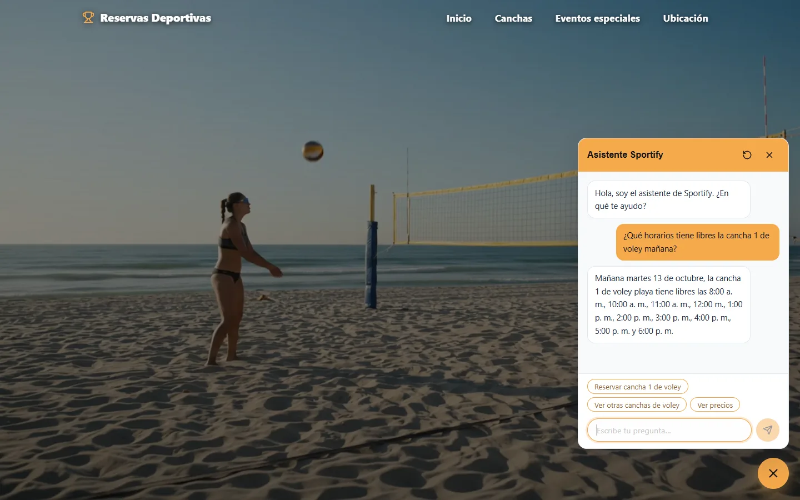 | 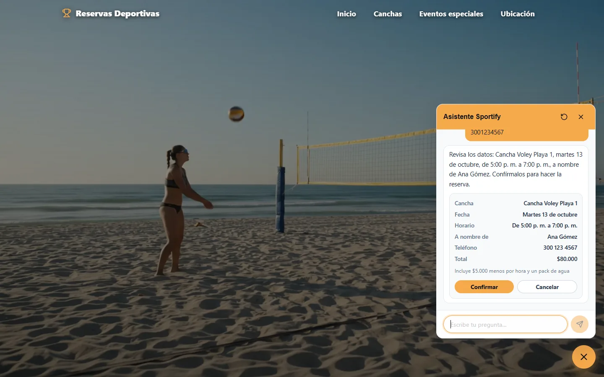 |

También **reserva y cancela**, siempre con la misma regla: *el modelo propone,
el usuario confirma y el código valida y ejecuta*.

- **Reservar:** cuando tiene cancha, fecha, horas, nombre y teléfono, muestra
  una tarjeta con el resumen y el total. La reserva se hace solo al tocar
  *Confirmar* o responder "sí", con la misma función del formulario. Si la
  franja se ocupó entretanto, no reserva nada y ofrece las otras libres.
- **Cancelar:** busca las reservas individuales futuras con el mismo nombre y
  teléfono y, tras confirmar, libera la franja. Si la persona tiene su código
  `SPF-XXXXXX` o reservó desde el formulario sin teléfono, el asistente la
  orienta a **"Mis reservas"** en el menú superior (donde también puede
  consultar torneos y cumpleaños). No cancela eventos ni reservas a menos de 6
  horas de empezar.

<p align="center">
  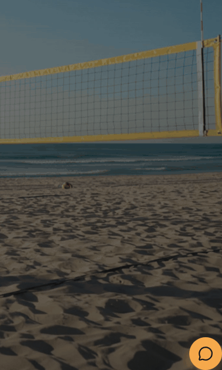
</p>

El asistente toma el color del deporte que se está viendo. La conversación se
conserva al cambiar de página o recargar la pestaña, y "Nueva conversación" la
borra.

### Versión móvil

Todo el sitio funciona en el celular. El asistente y el modal de **Mis
reservas** se adaptan a pantallas pequeñas y respetan las zonas seguras. El
modo torneo muestra un paso a la vez y las llaves se desplazan dentro de su
propio recuadro, sin mover la página.

<p align="center">
  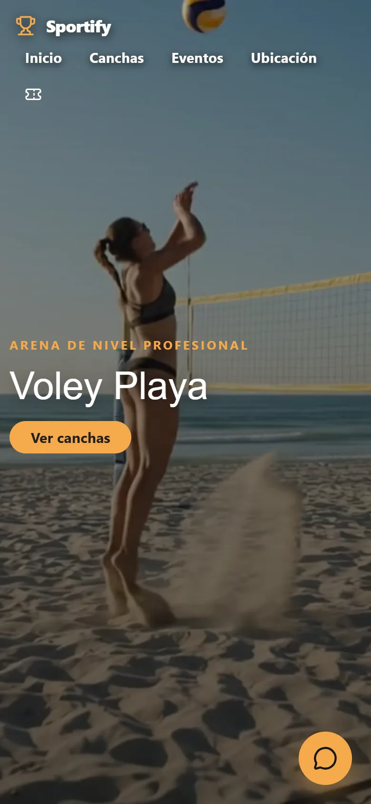
  &nbsp;&nbsp;
  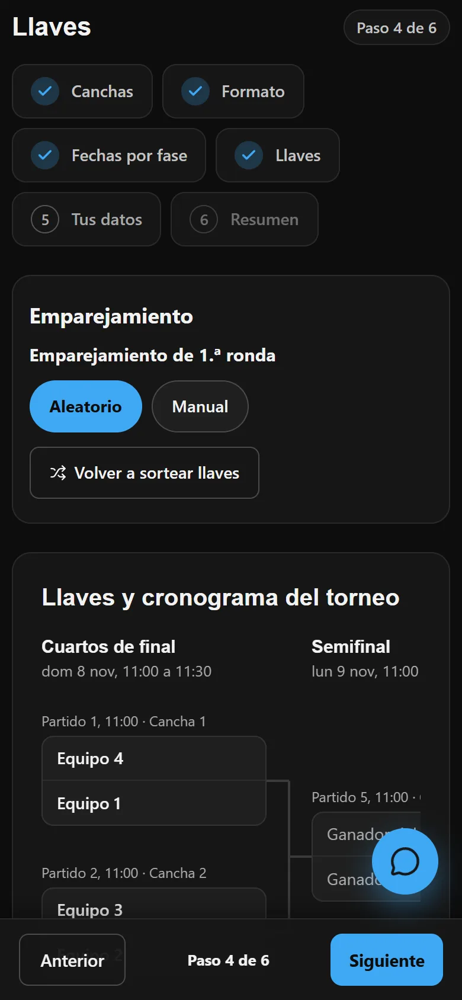
  &nbsp;&nbsp;
  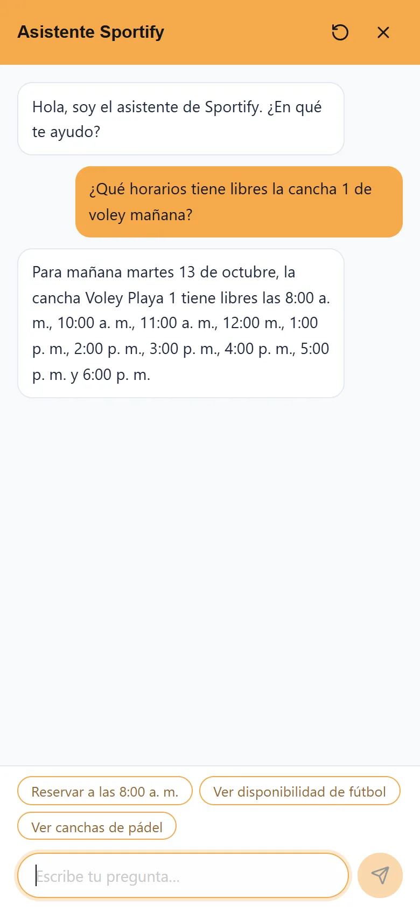
</p>

---

## Reglas del negocio

Los datos salen de `src/data/canchas.json`, `src/data/negocio.json`,
`src/lib/precios.js` y `src/lib/torneo.js`; ningún componente los escribe a
mano.

| Regla | Valor |
|---|---|
| Horario | Lunes a domingo, 8:00 a 21:00 (13 franjas de una hora) |
| Ventana de reserva | Hoy y los 6 días siguientes; las horas de hoy que ya empezaron no se pueden reservar |
| Reserva de cancha | De 1 a 3 horas seguidas |
| Beneficio | Desde 2 horas seguidas: $5.000 menos por hora y un pack de agua gratis (por cancha y jornada en eventos/torneos) |
| Torneos | De 1 a 3 canchas de un mismo deporte (hasta 2 con 4 equipos), 4/8/16 equipos por fases de eliminación directa en uno o varios días y bracket interactivo |
| Cumpleaños | Varias canchas (incluso de distintos deportes), un rango de horas consecutivas y hasta 100 invitados; bloqueo todo o nada |
| Datos de la reserva | Nombre obligatorio (solo letras); teléfono opcional en el formulario y obligatorio en el chat (10 dígitos, empieza por 3). Una reserva sin teléfono solo se consulta o cancela por su código `SPF-XXXXXX` en **Mis reservas** |
| Abono | 50 % del total en las 2 horas siguientes, por Nequi o transferencia Bancolombia |
| Cancelación | Sin costo hasta 6 horas antes (solo reservas individuales de cancha); después, el abono no se devuelve. Torneos y cumpleaños se gestionan llamando al local |
| Medios de pago | Efectivo, Nequi, Daviplata, transferencia Bancolombia y tarjeta en el local |

| Canchas | Precio por hora |
|---|---|
| Voley playa 1, 2 y 3 | $45.000 |
| Pádel 1, 2 y 3 | $65.000 |
| Fútbol 1 | $120.000 |
| Fútbol 2 y 3 | $100.000 |

Ejemplo: 2 horas de pádel cuestan $130.000 − $10.000 = **$120.000**, con un
pack de agua.

---

## Arquitectura

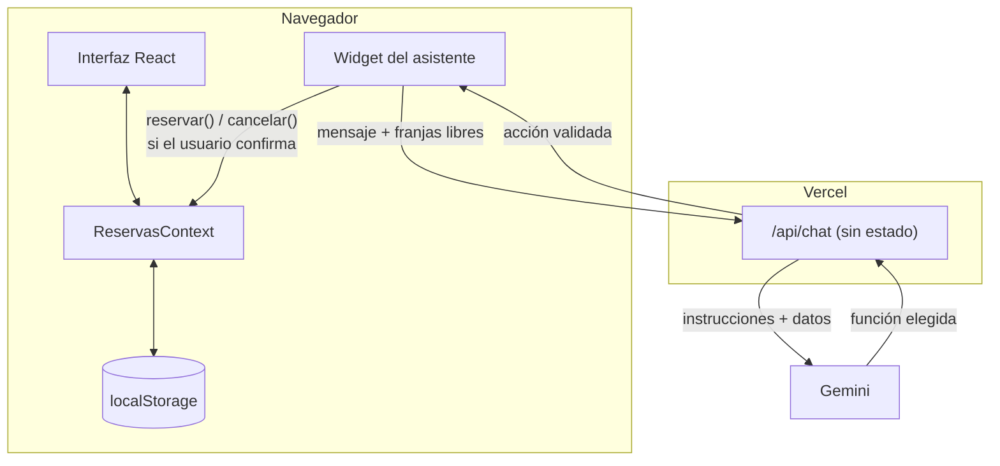

**Estado sin base de datos.** `src/context/ReservasContext.jsx` es la única
fuente de verdad. Guarda las horas ocupadas por cancha y fecha durante 7 días,
y los registros de reserva. Se espeja en `localStorage` en cada cambio. Al
iniciar fusiona lo guardado con la ocupación semilla de `canchas.json`, y
descarta las fechas que salieron de la ventana. Cada reserva se valida dos
veces: antes de despachar la acción y otra vez dentro del reducer.

**El asistente nunca escribe reservas.** En cada mensaje el navegador envía a
`/api/chat` el historial reciente y una foto de la disponibilidad. La función
hace **una llamada** a Gemini, con los datos del negocio, los precios y
la disponibilidad en las instrucciones. El modelo siempre responde llamando
una de cuatro funciones: `responder`, `proponer_reserva`,
`proponer_cancelacion` o `abrir_seccion`. El servidor valida los argumentos
con `src/lib/validacion.js`, el mismo módulo del formulario, y devuelve una
**acción propuesta**. Si los datos no son válidos, responde con un texto fijo
sin volver a llamar al modelo.

**Respaldo automático de modelo.** Si el modelo principal falla con un error
transitorio (503, 500, 429, 404) o se cuelga, la función repite la consulta
con los modelos de respaldo, dentro de un presupuesto de 17 s (el widget
espera 20 s). El principal tiene hasta 7 s y cada respaldo hasta 6 s. Un
modelo que acaba de fallar se deja de lado 60 s, para no esperarlo en cada
mensaje durante una caída. Los errores 400, 401 y 403 no se reintentan,
porque ningún modelo los resolvería. La lógica está en
`src/lib/modelosChat.js`, con sus tests.

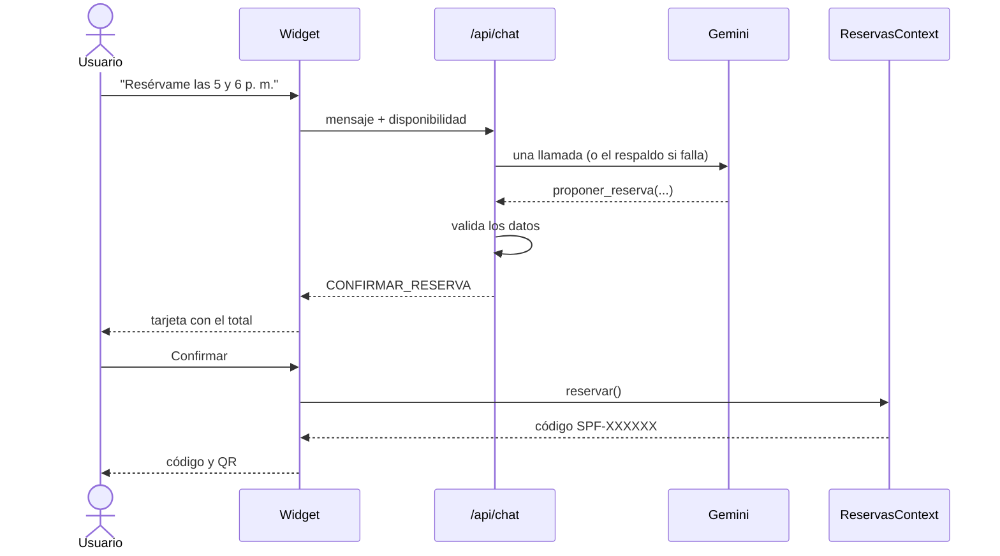

**Contrato de `/api/chat`:**

| Parte | Detalle |
|---|---|
| Petición | `POST` JSON (máx. 48 KB): `mensaje` (1-500 caracteres), `historial` (últimos 20 turnos) y `contexto` (fecha, hora y franjas libres de 7 días; el catálogo sale de `canchas.json`) |
| Respuesta | Siempre `{ respuesta, sugerencias, accion }`, también en los errores |
| Acciones | `CONFIRMAR_RESERVA`, `BUSCAR_CANCELACION`, `ABRIR_SECCION` o `null` |
| Errores | 405 método, 400 petición inválida y, cuando fallan todos los modelos: 429 si todos agotaron su cuota, 504 si alguno se colgó y 502 en los demás casos |

---

## Stack tecnológico

| Área | Tecnología |
|---|---|
| Interfaz | React 19.2 · Vite 8 (`@vitejs/plugin-react`) |
| Maquetación | Foundation 6.8 (`foundation-sites`, solo CSS) |
| Animación | GSAP 3.13 + ScrollTrigger |
| Componentes de terceros | DepthCarousel y AccordionGallery de [React Bits](https://reactbits.dev), adaptados |
| Íconos y QR | `lucide-react` · `qrcode.react` |
| Asistente | `@google/genai` 2.28 (modelo `gemini-3.5-flash-lite` por defecto) en una Vercel Function de Node |
| Pruebas | Vitest 5 + Testing Library (jsdom) |
| Calidad de código | ESLint 10 (configuración plana) |
| Hosting | Vercel (despliegue automático desde `main`) |

---

## Estructura del proyecto

```
api/
├── chat.js              POST /api/chat: valida la petición, llama a Gemini una vez y
│                        convierte su respuesta en texto, sugerencias y una acción propuesta
└── _lib/                Helpers de la función (no se vuelven rutas)
    ├── peticion.js      Validación de la petición y del contexto (el catálogo sale de canchas.json)
    ├── instrucciones.js Instrucciones del asistente, armadas con los datos del sitio
    └── funciones.js     Declaración de las 4 funciones y validación de sus argumentos
docs/capturas/           Capturas y GIF de este README
scripts/
└── probar-chat.mjs      Casos de prueba de /api/chat (local o producción)
src/
├── components/
│   ├── layout/          Navbar, Footer, PaginaInicio y MisReservas (consulta por código o teléfono, QR y cancelación)
│   ├── hero/            DeporteHero: heros por deporte con video y pinning
│   ├── canchas/         VistaCanchas: la página de reserva (/reservar/<deporte>)
│   ├── reservas/        useReserva, formulario, comprobante (voucher), selector de modo, confirmación con QR
│   │   └── torneo/      Bracket, SeccionLlaves, IndicadorPasos, CalendarioTorneo, AlertaTiempo, asistente móvil y bloques Paso*
│   ├── eventos/         EventoCTA: sección de eventos y torneos
│   ├── ubicacion/       Ubicacion: dirección, teléfono, horario y mapa
│   ├── shared/          SelectorDia: tira de 7 días con horarios libres
│   ├── reactbits/       DepthCarousel y AccordionGallery (React Bits)
│   └── chatbot/         Widget del asistente: panel, mensajes, tarjetas de reserva y
│                        cancelación, y los hooks useChatbot, useAccionesReserva,
│                        useAccionesChat y useDeporteActivo
├── context/
│   ├── ReservasContext.jsx      Estado de reservas (RESERVAR, RESERVAR_EVENTO, CANCELAR)
│   └── VistaCanchasContext.jsx  Navegación entre el inicio y la página de reserva, sincronizada con la URL
├── data/
│   ├── canchas.json     Semilla: horas, ocupación por día y catálogo de cada cancha
│   ├── negocio.json     Datos del local: contacto, mapa, pagos, cancelación, servicios
│   └── deportes.js      Nombre y color de acento de cada deporte
├── lib/                 Lógica pura, con sus tests al lado (*.test.js)
│   ├── precios.js       Reglas de precio y descuento
│   ├── torneo.js        Fases de eliminación directa, bracket, validación de jornadas y precios de torneo
│   ├── pasosTorneo.js   Pasos del torneo: completitud, motivo y a cuáles se puede saltar
│   ├── horarios.js      Selección de horas (bloque de hasta 3 o rango)
│   ├── validacion.js    Nombre, teléfono y reserva propuesta por el chat
│   ├── cancelacion.js   Plazo de cancelación, estado resultante y búsqueda de reservas
│   ├── modelosChat.js   Respaldo de modelo del asistente: orden, tiempos y respuesta final
│   ├── chat.js          Contexto que envía el widget, historial, sí/no y textos fijos
│   ├── codigoReserva.js Código de reserva y texto del QR
│   ├── fechas.js        Etiquetas de fecha, horas a. m./p. m. y horas pasadas
│   ├── canchas.js       Agrupación por deporte, imágenes y estilo de acento
│   ├── rutas.js         Construcción y lectura de las rutas del sitio (/ y /reservar/<deporte>)
│   └── negocio.js       Teléfono del local y horario a partir de las franjas
├── App.jsx              Providers + Navbar + página activa (inicio o reserva) + Footer + asistente
└── main.jsx             Punto de entrada: CSS de Foundation, estilos globales y montaje de <App />
index.html               Página base; carga src/main.jsx como módulo
vite.config.mjs          Plugin de React, polling opcional del watcher y configuración de Vitest
eslint.config.mjs        ESLint 10 en configuración plana
vercel.json              Preset de Vite, rewrite de /reservar/* e includeFiles de la función /api/chat
```

---

## Instalación y uso local

**Requisitos:** Node.js 22.12 o superior (el proyecto se desarrolló con Node 24)
y npm. Para probar el asistente en local se necesita además la
[CLI de Vercel](https://vercel.com/docs/cli) y una API key de Gemini.

```bash
git clone https://github.com/JuanFierro15/ProyectoSportify.git
cd ProyectoSportify
npm install
npm run dev        # http://localhost:5173
```

`npm run dev` sirve el sitio completo, pero **no ejecuta** la función
`/api/chat`, así que el asistente responde con su mensaje de error. Para
probarlo en local:

1. Crea una API key en [Google AI Studio](https://aistudio.google.com/apikey).
2. Copia `.env.example` a `.env.local` y pon tu key en `GEMINI_API_KEY`.
3. Enlaza el proyecto con `vercel link` y levanta el sitio junto con la
   función. `vercel dev` no le pasa a la función las variables de
   `.env.local`, así que hay que cargarlas antes en la terminal (Git Bash):

   ```bash
   set -a; . <(tr -d '\r' < .env.local); set +a; vercel dev
   ```

| Variable | Uso |
|---|---|
| `GEMINI_API_KEY` | Obligatoria para el asistente. Solo la lee `/api/chat` |
| `GEMINI_MODEL` | Opcional. Modelo principal de Gemini (por defecto `gemini-3.5-flash-lite`) |
| `GEMINI_MODELOS_RESPALDO` | Opcional. Modelos de respaldo separados por comas (por defecto `gemini-3.1-flash-lite,gemini-3.6-flash`). Vacía deja el chat sin respaldo. Deben aceptar `thinkingLevel: MINIMAL` |
| `CHOKIDAR_USEPOLLING` | Opcional, solo desarrollo: con `true`, `vite.config.mjs` activa el polling del watcher de Vite, lo que evita que el servidor se caiga en Windows al copiar archivos en `public/media/` |

> **Importante:** nunca pongas la key en una variable `VITE_*`. Esas
> variables quedan incrustadas en el JavaScript público del sitio. `.env` y
> `.env.local` están en `.gitignore`.

---

## Pruebas

```bash
npm test                          # 197 tests en 16 archivos (Vitest)
npm run lint                      # ESLint sobre src, api y scripts
npm run build                     # build de producción en /dist
```

El lint se corre aparte: ya no forma parte del build ni del servidor de
desarrollo. `npm run test:watch` deja Vitest observando los cambios.

Las pruebas unitarias y de componentes cubren la lógica pura de `src/lib/`
(precios y descuentos, fases y bracket de torneos, selección de horas,
validación de nombre, teléfono y reservas propuestas, fechas, código y texto
del QR, datos del negocio, rutas del sitio, plazo y búsqueda de cancelaciones,
contexto e historial del chat y respaldo de modelo) además de las pruebas de
interfaz para torneos y cumpleaños (`src/components/reservas/Torneo.test.jsx`,
que cubren las llaves simétricas, la denominación "Ganador del partido N", la
final con el trofeo y el indicador de pasos), el asistente de un paso a la vez
del torneo en el celular y las secciones del formulario que muestra cada paso,
consulta en **Mis reservas** y
montaje general en `src/App.test.jsx`.

El asistente tiene además un script con 12 casos contra la función real:
disponibilidad, "resérvalo" con una y con varias franjas, datos válidos e
inválidos, hora ocupada, ubicación, parqueadero, proceso de torneo por fases,
cancelación con código y una pregunta fuera de tema.

```bash
node scripts/probar-chat.mjs                                     # contra vercel dev (localhost:3000)
node scripts/probar-chat.mjs https://proyecto-sportify.vercel.app # contra producción
node scripts/probar-chat.mjs <url> reservalo-varias parqueadero   # solo algunos casos
```

---

## Despliegue

El sitio está en Vercel y **cada push a `main` despliega a producción**.

- **Variables de entorno:** `GEMINI_API_KEY` (sensible) y `GEMINI_MODEL`, en
  los entornos *Production* y *Preview*. Aplican desde el siguiente
  despliegue.
- **`vercel.json`:** fija el preset de Vite (`"framework": "vite"`), redirige
  `/reservar/:path*` a `/index.html` para que las rutas de reserva funcionen al
  recargar o compartir, y agrega `@google/genai/dist/node/index.cjs` a la
  función con `includeFiles`. La función se compila a CommonJS y el rastreo de
  archivos de Vercel solo incluía la versión ESM del paquete.
- **`.vercelignore`:** es una lista blanca (`src`, `public`, `api`,
  `index.html`, `vite.config.mjs`, `vercel.json` y los `package*.json`), así
  que los videos fuente y la documentación no se suben al build.

---

## Accesibilidad y rendimiento

- **Contraste verificado:** contraste mínimo de 4,5:1 (WCAG AA) medido en todo
  texto de la página de reserva contra sus superficies oscuras con los tres
  colores de acento (`futbol` `#5bd67d`, `padel` `#3fa9f5` y `voley-playa`
  `#f6a94b`), incluyendo las horas reservadas deshabilitadas (4,58:1), textos
  secundarios y comprobante.
- **Navegación por teclado y foco visible:** contorno `:focus-visible` de alto
  contraste en todos los controles interactivos, supresión del anillo
  programático en el `<h1>` al abrir la página de reserva y soporte de flechas
  (`ArrowLeft`, `ArrowRight`, `Home`, `End` con `tabIndex` móvil) en las
  pestañas de deporte, con áreas táctiles mínimas de 44 px.
- **Movimiento reducido:** respeto estricto de `prefers-reduced-motion`:
  desactiva las animaciones GSAP de entrada, las transiciones de la
  confirmación, el zoom lento de las fotos del carrusel y el panel del
  asistente, mostrando los estados de inmediato sin transiciones innecesarias.
- Todo indicador visual de disponibilidad va con texto ("10 de 13 horarios
  libres", "ocupado", "completo").
- El color de acento de cada deporte se aplica con un color de texto que
  cumple el contraste WCAG (`--accent-contrast` y `--accent-text` en
  `estiloAcento`, `src/lib/canchas.js`).
- El asistente, el visor de fotos y el modal de **Mis reservas** se cierran con
  `Escape` y devuelven el foco al botón que los abrió. Los mensajes y avisos se
  anuncian con `aria-live`.
- Los videos de los heros son *all-intra* (un keyframe por cuadro), 1080p30,
  sin audio y cuentan con imagen `poster` de respaldo, para que avanzar y
  retroceder con el scroll sea inmediato y fluido.
- Las fotos de las canchas son WebP en dos tamaños (720 y 1440 px) con
  `srcSet`. El mapa y la galería de eventos cargan en diferido
  (`loading="lazy"`).

---

## Avance por bloques

| Bloque | Estado |
|---|---|
| 1. Estructura base con Foundation (navbar, footer, grid) | ✅ |
| 2. Heros por deporte con GSAP y ScrollTrigger | ✅ |
| 3. Catálogo de canchas: página de reserva con carrusel 3D | ✅ |
| 4. Sistema de reservas: 1 a 3 horas, descuento, validación de choques | ✅ |
| 5. Modo evento: torneos por fases multi-día, bracket interactivo y cumpleaños | ✅ |
| 6. Asistente: función `/api/chat`, widget y reservas o cancelaciones desde el chat | ✅ |
| 7. Consulta de **Mis reservas** (código/teléfono, QR y cancelación) y auditoría de usabilidad | ✅ |

---

## Créditos

- **Material visual:** creado con Gemini. Las fotos de las canchas se hicieron
  con **Nano Banana** y los videos de fondo de los heros con **Omni**.
- **Componentes:** `DepthCarousel` y `AccordionGallery` vienen de
  [React Bits](https://reactbits.dev) (David Haz, licencia MIT + Commons
  Clause) y se adaptaron para el proyecto.
- **Librerías:** [React](https://react.dev),
  [Foundation](https://get.foundation),
  [GSAP](https://gsap.com), [Lucide](https://lucide.dev),
  [qrcode.react](https://github.com/zpao/qrcode.react) y el SDK
  [@google/genai](https://github.com/googleapis/js-genai).
- **Mapa:** Google Maps (iframe de inserción).

---

## Autor

**Juan Fierro** · [@JuanFierro15](https://github.com/JuanFierro15)

Proyecto académico de la materia Lenguajes para la Web, Universidad
Surcolombiana.
