# Sportify · Reservas Deportivas

Sitio web de un local deportivo en Neiva para reservar canchas de **voley
playa, pádel y fútbol**, organizar **torneos y cumpleaños**, y resolver dudas
con un **asistente conversacional** que también reserva y cancela.

[](https://proyecto-sportify.vercel.app)


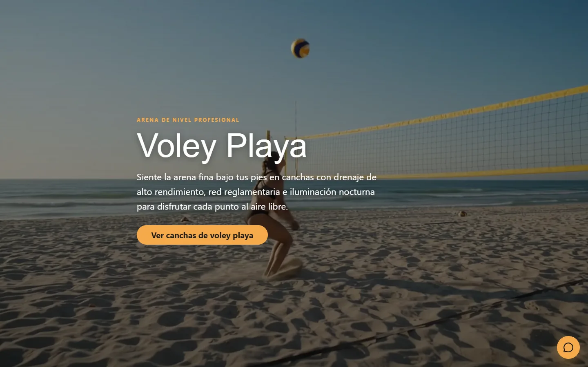

**Demo en vivo:** <https://proyecto-sportify.vercel.app>

---

## Contenido

- [Sobre el proyecto](#sobre-el-proyecto)
- [Funcionalidades](#funcionalidades)
- [Reglas del negocio](#reglas-del-negocio)
- [Arquitectura](#arquitectura)
- [Stack tecnológico](#stack-tecnológico)
- [Estructura del proyecto](#estructura-del-proyecto)
- [Instalación y uso local](#instalación-y-uso-local)
- [Pruebas](#pruebas)
- [Despliegue](#despliegue)
- [Accesibilidad y rendimiento](#accesibilidad-y-rendimiento)
- [Avance por bloques](#avance-por-bloques)
- [Créditos](#créditos)
- [Autor](#autor)

---

## Sobre el proyecto

Proyecto final de la materia **Lenguajes para la Web** (Universidad
Surcolombiana, sexto semestre). El enunciado fija estas restricciones:

| Restricción | Cómo se cumple |
|---|---|
| Frontend en React | Create React App 5 con React 19, componentes funcionales y Hooks |
| Maquetación con Foundation | `foundation-sites` 6 (grid XY, botones, pestañas y utilidades) |
| Sin base de datos | Estado de React (`Context` + `useReducer`) espejado en `localStorage`, más un JSON semilla |
| Chatbot | Asistente con Gemini detrás de una función de servidor de Vercel (`/api/chat`), acotado al negocio |
| Animaciones con GSAP | GSAP + ScrollTrigger sobre la estructura de Foundation |

---

## Funcionalidades

### Un hero por deporte

Cada deporte tiene su sección a pantalla completa con un video de fondo que
avanza con el scroll: la sección queda fija (*pinning* de ScrollTrigger) y el
`currentTime` del video sigue a la rueda del mouse. Cada una tiene su color de
acento, que después usan la vista de canchas y el asistente.

| Voley playa | Pádel | Fútbol |
|:---:|:---:|:---:|
|  | 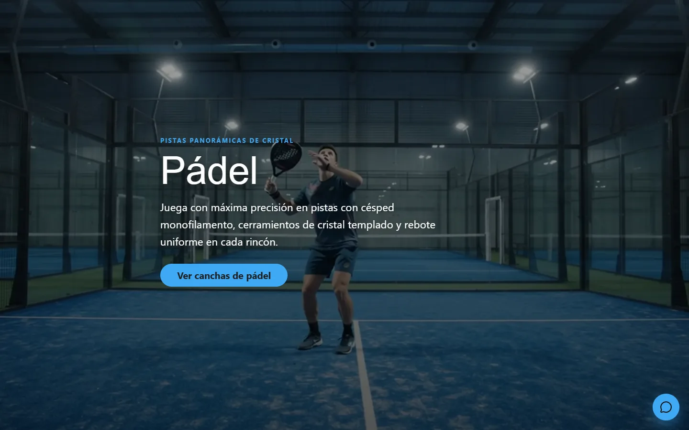 | 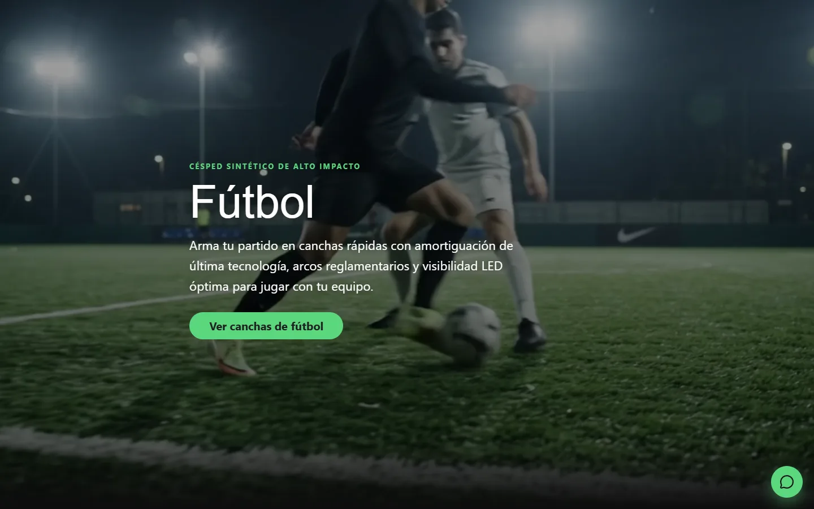 |

### Vista de canchas: la ventana de reserva

Todo se reserva desde una sola vista a pantalla completa. Se abre desde
"Ver canchas de…" en cada hero o desde "Canchas" en el menú. Tiene:

- **Pestañas por deporte** y el filtro *Solo con horarios libres ese día*.
- **Carrusel 3D** con la foto, las características, el precio y cuántos
  horarios libres tiene cada cancha el día elegido.
- **Visor en grande** de la foto, con su propio botón para elegir horario.
- **URL compartible:** la vista cambia el hash (`#canchas-padel`), así que un
  enlace abre directo un deporte y el botón "atrás" del navegador la cierra.

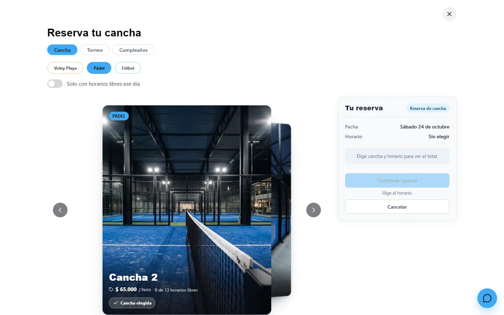

### Reserva de una cancha

Se elige el día (hoy y los 6 siguientes, cada uno con su número de horarios
libres) y de **1 a 3 horas seguidas**. Desde 2 horas cada hora cuesta
$5.000 menos y se regala un pack de agua. A la derecha, el **voucher** muestra
el total en vivo y, mientras falte algo, el motivo por el que todavía no se
puede confirmar.

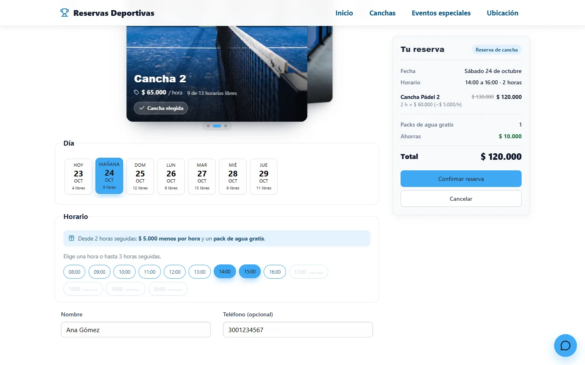

Al confirmar se genera un **código de reserva** (`SPF-XXXXXX`) y un **QR** con
los datos de la reserva (tipo, fecha, horario, cancha, nombre y total), que se
puede descargar para mostrarlo al llegar.

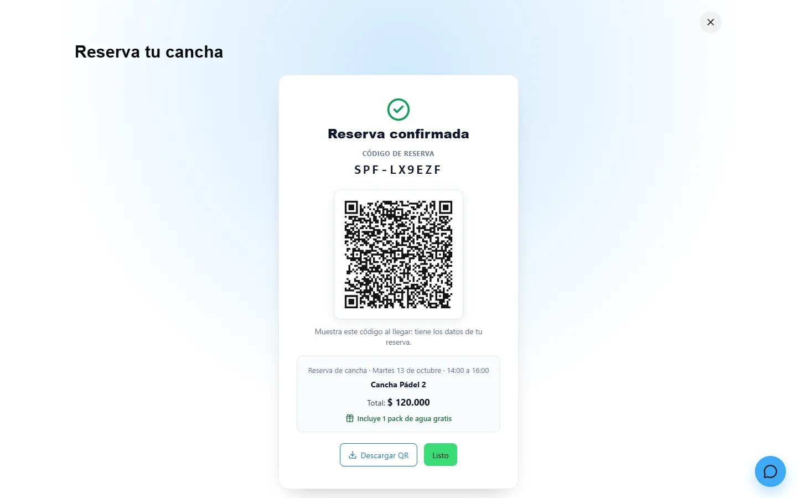

### Torneos y cumpleaños

La misma vista tiene los modos **Cancha · Torneo · Cumpleaños**. En los de
evento:

- se agregan **varias canchas**, incluso de distintos deportes;
- se elige un **rango de horas**: inicio y fin, y quedan elegidas todas las de
  en medio;
- el bloqueo es **todo o nada**: si una sola celda cancha × hora está ocupada,
  no se reserva nada;
- el precio es la suma por cancha, con las mismas reglas de descuento.

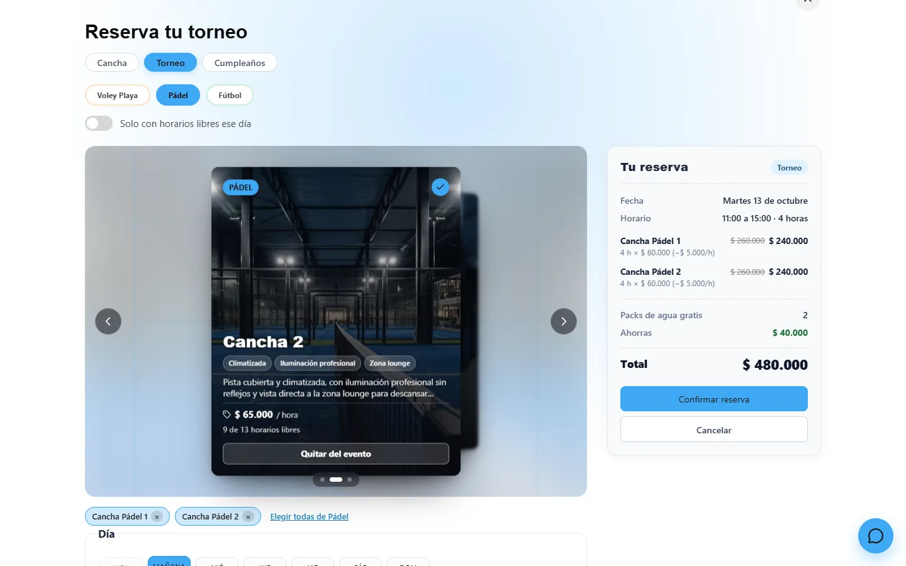

La sección **Eventos y torneos** de la página muestra cifras reales del local
(deportes, canchas, días y horario, con un conteo animado) y una galería por
tipo de evento.

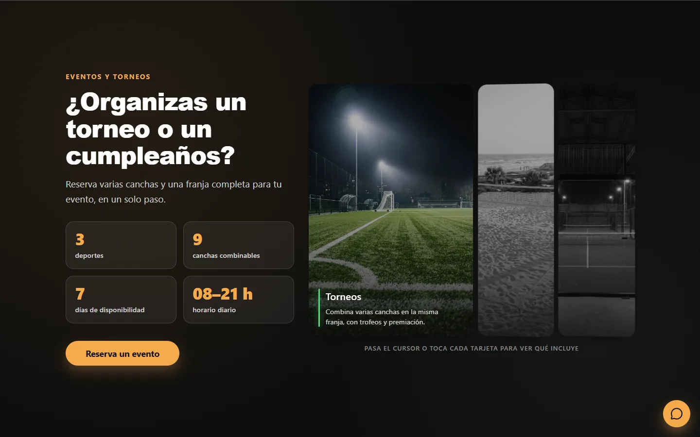

### Ubicación y contacto

La sección **Visítanos** muestra la dirección, el teléfono (con enlace para
llamar), el horario y un mapa de Google con el botón "Cómo llegar". Los datos
salen de un único archivo (`src/data/negocio.json`), así que la sección, el
footer y el asistente siempre coinciden.

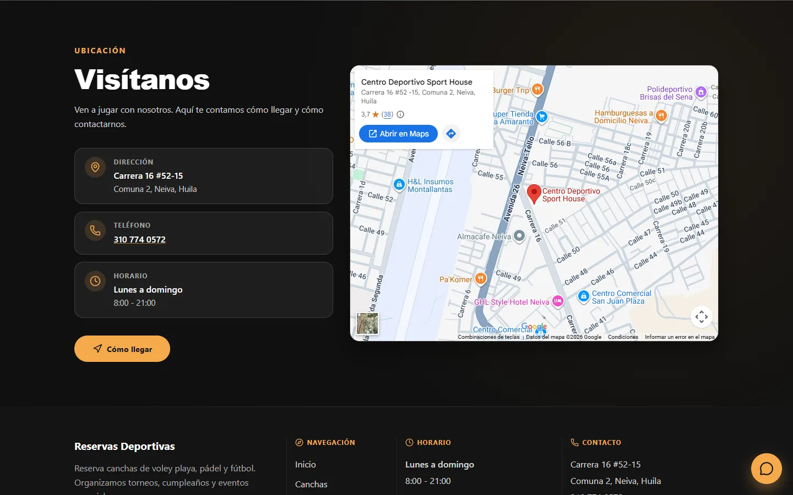

### Asistente conversacional

Un botón flotante abre el **Asistente Sportify**, disponible en todas las
vistas. Responde sobre horarios libres, precios, servicios, pagos, política de
cancelación y ubicación. Cuando la respuesta lo amerita, ofrece un botón para
abrir las canchas, la reserva de eventos o la ubicación.

| Consulta de disponibilidad | Reserva propuesta |
|:---:|:---:|
| 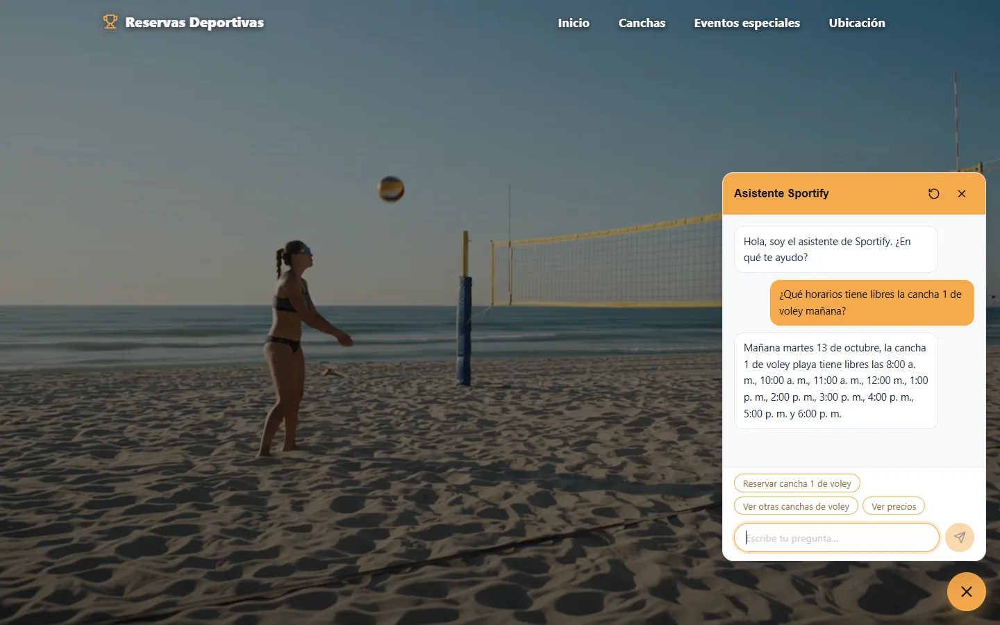 | 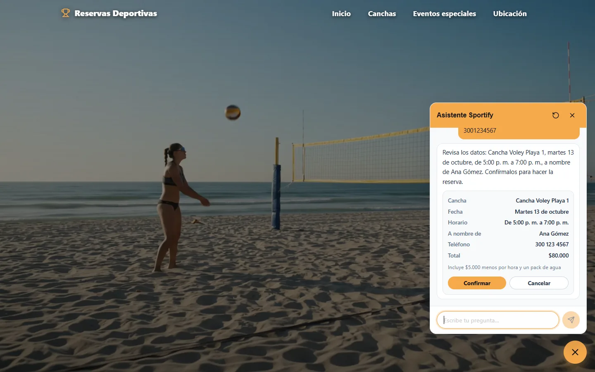 |

También **reserva y cancela**, siempre con la misma regla: *el modelo propone,
el usuario confirma y el código valida y ejecuta*.

- **Reservar:** cuando tiene cancha, fecha, horas, nombre y teléfono, muestra
  una tarjeta con el resumen y el total. La reserva se hace solo al tocar
  *Confirmar* o responder "sí", con la misma función del formulario. Si la
  franja se ocupó entretanto, no reserva nada y ofrece las otras libres.
- **Cancelar:** busca las reservas futuras con el mismo nombre y teléfono y,
  tras confirmar, libera la franja. No cancela eventos ni reservas a menos de
  6 horas de empezar.

<p align="center">
  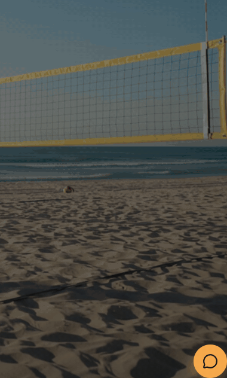
</p>

El asistente toma el color del deporte que se está viendo. La conversación se
conserva al recargar la pestaña, y "Nueva conversación" la borra.

### Versión móvil

Todo el sitio funciona en el celular. El asistente se abre a pantalla
completa y respeta las zonas seguras de la pantalla.

<p align="center">
  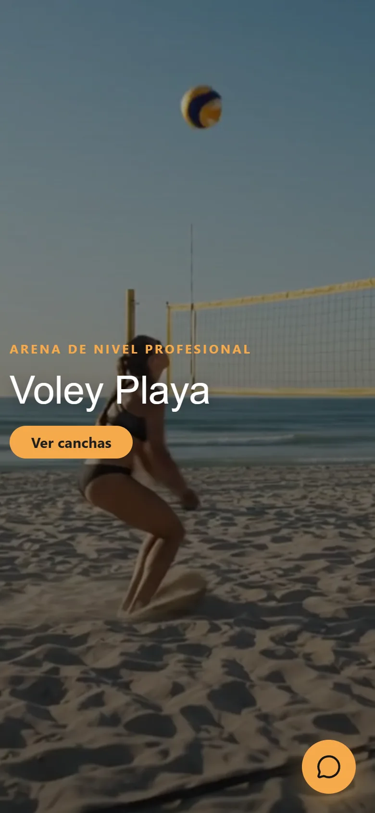
  &nbsp;&nbsp;
  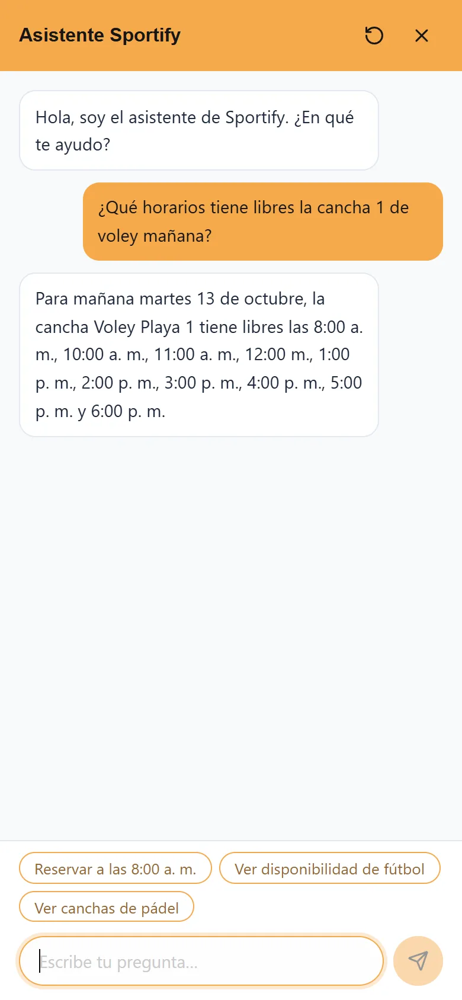
</p>

---

## Reglas del negocio

Los datos salen de `src/data/canchas.json`, `src/data/negocio.json` y
`src/lib/precios.js`; ningún componente los escribe a mano.

| Regla | Valor |
|---|---|
| Horario | Lunes a domingo, 8:00 a 21:00 (13 franjas de una hora) |
| Ventana de reserva | Hoy y los 6 días siguientes; las horas de hoy que ya empezaron no se pueden reservar |
| Reserva de cancha | De 1 a 3 horas seguidas |
| Beneficio | Desde 2 horas seguidas: $5.000 menos por hora y un pack de agua gratis (por cancha en los eventos) |
| Eventos | Varias canchas y un rango de horas consecutivas, bloqueo todo o nada |
| Datos de la reserva | Nombre obligatorio (solo letras); teléfono opcional en el formulario y obligatorio en el chat (10 dígitos, empieza por 3) |
| Abono | 50 % del total en las 2 horas siguientes, por Nequi o transferencia Bancolombia |
| Cancelación | Sin costo hasta 6 horas antes (solo reservas de cancha); después, el abono no se devuelve |
| Medios de pago | Efectivo, Nequi, Daviplata, transferencia Bancolombia y tarjeta en el local |

| Canchas | Precio por hora |
|---|---|
| Voley playa 1, 2 y 3 | $45.000 |
| Pádel 1, 2 y 3 | $65.000 |
| Fútbol 1 | $120.000 |
| Fútbol 2 y 3 | $100.000 |

Ejemplo: 2 horas de pádel cuestan $130.000 − $10.000 = **$120.000**, con un
pack de agua.

---

## Arquitectura

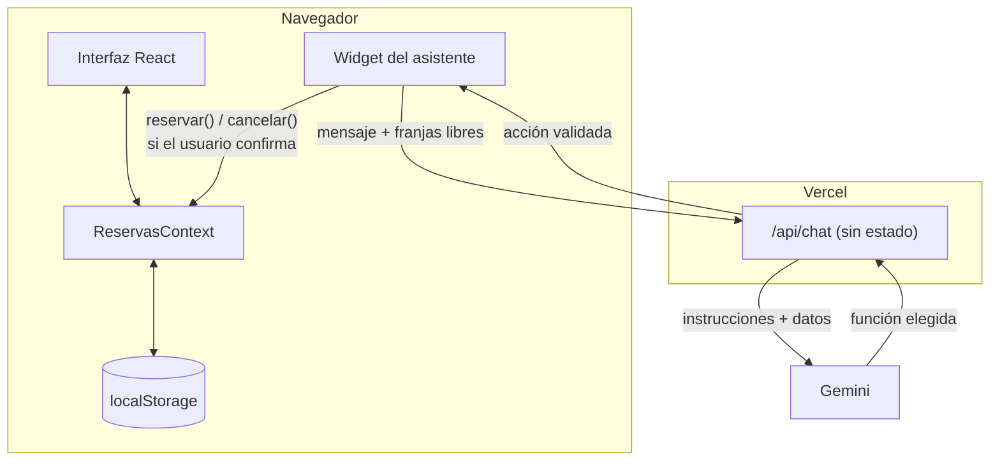

**Estado sin base de datos.** `src/context/ReservasContext.jsx` es la única
fuente de verdad. Guarda las horas ocupadas por cancha y fecha durante 7 días,
y los registros de reserva. Se espeja en `localStorage` en cada cambio. Al
iniciar fusiona lo guardado con la ocupación semilla de `canchas.json`, y
descarta las fechas que salieron de la ventana. Cada reserva se valida dos
veces: antes de despachar la acción y otra vez dentro del reducer.

**El asistente nunca escribe reservas.** En cada mensaje el navegador envía a
`/api/chat` el historial reciente y una foto de la disponibilidad. La función
hace **una sola llamada** a Gemini, con los datos del negocio, los precios y
la disponibilidad en las instrucciones. El modelo siempre responde llamando
una de cuatro funciones: `responder`, `proponer_reserva`,
`proponer_cancelacion` o `abrir_seccion`. El servidor valida los argumentos
con `src/lib/validacion.js`, el mismo módulo del formulario, y devuelve una
**acción propuesta**. Si los datos no son válidos, responde con un texto fijo
sin volver a llamar al modelo.

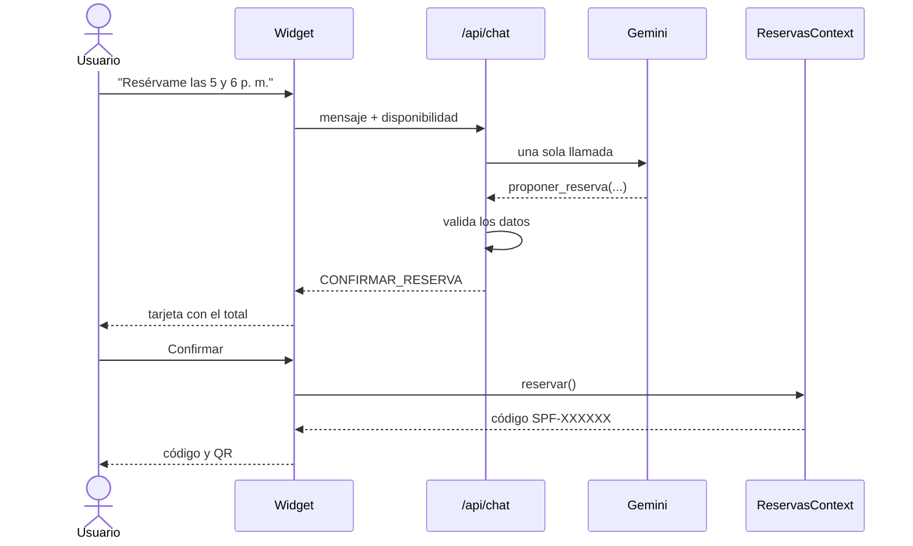

**Contrato de `/api/chat`:**

| Parte | Detalle |
|---|---|
| Petición | `POST` JSON (máx. 48 KB): `mensaje` (1-500 caracteres), `historial` (últimos 20 turnos) y `contexto` (fecha, hora, canchas y franjas libres de 7 días) |
| Respuesta | Siempre `{ respuesta, sugerencias, accion }`, también en los errores |
| Acciones | `CONFIRMAR_RESERVA`, `BUSCAR_CANCELACION`, `ABRIR_SECCION` o `null` |
| Errores | 405 método, 400 petición inválida, 429 límite del modelo, 502/504 otros fallos o tiempo agotado (15 s) |

---

## Stack tecnológico

| Área | Tecnología |
|---|---|
| Interfaz | React 19.2 · Create React App 5 (`react-scripts` 5.0.1) |
| Maquetación | Foundation 6.8 (`foundation-sites`, solo CSS) |
| Animación | GSAP 3.13 + ScrollTrigger |
| Componentes de terceros | DepthCarousel y AccordionGallery de [React Bits](https://reactbits.dev), adaptados |
| Íconos y QR | `lucide-react` · `qrcode.react` |
| Asistente | `@google/genai` 2.28 (modelo `gemini-3.5-flash-lite` por defecto) en una Vercel Function de Node |
| Pruebas | Jest 27 + Testing Library |
| Hosting | Vercel (despliegue automático desde `main`) |

---

## Estructura del proyecto

```
api/
├── chat.js              POST /api/chat: valida la petición, llama a Gemini una vez y
│                        convierte su respuesta en texto, sugerencias y una acción propuesta
└── _lib/                Helpers de la función (no se vuelven rutas)
    ├── peticion.js      Validación de la petición y del contexto (el catálogo sale de canchas.json)
    ├── instrucciones.js Instrucciones del asistente, armadas con los datos del sitio
    └── funciones.js     Declaración de las 4 funciones y validación de sus argumentos
docs/capturas/           Capturas y GIF de este README
scripts/
└── probar-chat.mjs      Casos de prueba de /api/chat (local o producción)
src/
├── components/
│   ├── layout/          Navbar y Footer
│   ├── hero/            DeporteHero: heros por deporte con video y pinning
│   ├── canchas/         VistaCanchas: la ventana de reserva a pantalla completa
│   ├── reservas/        useReserva, formulario, voucher, selector de modo y confirmación con QR
│   ├── eventos/         EventoCTA: sección de eventos y torneos
│   ├── ubicacion/       Ubicacion: dirección, teléfono, horario y mapa
│   ├── shared/          SelectorDia: tira de 7 días con horarios libres
│   ├── reactbits/       DepthCarousel y AccordionGallery (React Bits)
│   └── chatbot/         Widget del asistente: panel, mensajes, tarjetas de reserva y
│                        cancelación, y los hooks useChatbot, useAccionesReserva,
│                        useAccionesChat y useDeporteActivo
├── context/
│   ├── ReservasContext.jsx      Estado de reservas (RESERVAR, RESERVAR_EVENTO, CANCELAR)
│   └── VistaCanchasContext.jsx  Qué vista está abierta, sincronizada con el hash
├── data/
│   ├── canchas.json     Semilla: horas, ocupación por día y catálogo de cada cancha
│   ├── negocio.json     Datos del local: contacto, mapa, pagos, cancelación, servicios
│   └── deportes.js      Nombre y color de acento de cada deporte
├── lib/                 Lógica pura, con sus tests al lado (*.test.js)
│   ├── precios.js       Reglas de precio y descuento
│   ├── horarios.js      Selección de horas (bloque de hasta 3 o rango)
│   ├── validacion.js    Nombre, teléfono y reserva propuesta por el chat
│   ├── cancelacion.js   Plazo de cancelación, estado resultante y búsqueda de reservas
│   ├── chat.js          Contexto que envía el widget, historial, sí/no y textos fijos
│   ├── codigoReserva.js Código de reserva y texto del QR
│   ├── fechas.js        Etiquetas de fecha, horas a. m./p. m. y horas pasadas
│   ├── canchas.js       Agrupación por deporte, imágenes y estilo de acento
│   └── negocio.js       Teléfono del local y horario a partir de las franjas
└── App.js               Providers + Navbar + heros + eventos + ubicación + Footer + asistente
```

---

## Instalación y uso local

**Requisitos:** Node.js 20 o superior (el proyecto se desarrolló con Node 24)
y npm. Para probar el asistente en local se necesita además la
[CLI de Vercel](https://vercel.com/docs/cli) y una API key de Gemini.

```bash
git clone https://github.com/JuanFierro15/ProyectoSportify.git
cd ProyectoSportify
npm install
npm start          # http://localhost:3000
```

`npm start` sirve el sitio completo, pero **no ejecuta** la función
`/api/chat`, así que el asistente responde con su mensaje de error. Para
probarlo en local:

1. Crea una API key en [Google AI Studio](https://aistudio.google.com/apikey).
2. Copia `.env.example` a `.env.local` y pon tu key en `GEMINI_API_KEY`.
3. Enlaza el proyecto con `vercel link` y levanta el sitio junto con la
   función. `vercel dev` no le pasa a la función las variables de
   `.env.local`, así que hay que cargarlas antes en la terminal (Git Bash):

   ```bash
   set -a; . <(tr -d '\r' < .env.local); set +a; vercel dev
   ```

| Variable | Uso |
|---|---|
| `GEMINI_API_KEY` | Obligatoria para el asistente. Solo la lee `/api/chat` |
| `GEMINI_MODEL` | Opcional. Modelo de Gemini (por defecto `gemini-3.5-flash-lite`) |
| `CHOKIDAR_USEPOLLING` | Opcional, solo desarrollo: evita que el servidor se caiga en Windows al copiar archivos en `public/media/` |

> **Importante:** nunca pongas la key en una variable `REACT_APP_*`. Esas
> variables quedan incrustadas en el JavaScript público del sitio. `.env` y
> `.env.local` están en `.gitignore`.

---

## Pruebas

```bash
npm test -- --watchAll=false      # 91 tests en 9 suites
npx eslint --ext .js,.jsx src     # lint (también corre dentro de start y build)
npm run build                     # build de producción en /build
```

Las pruebas unitarias cubren la lógica pura de `src/lib/`: precios y
descuentos, selección de horas, validación de nombre, teléfono y reservas
propuestas, fechas, código y texto del QR, datos del negocio, plazo y búsqueda
de cancelaciones, y el contexto, el historial y los textos fijos del chat.
`src/App.test.js` es un *smoke test* que monta la aplicación completa.

El asistente tiene además un script con 10 casos contra la función real:
disponibilidad, "resérvalo" con una y con varias franjas, datos válidos e
inválidos, hora ocupada, ubicación, parqueadero y una pregunta fuera de tema.

```bash
node scripts/probar-chat.mjs                                     # contra vercel dev (localhost:3000)
node scripts/probar-chat.mjs https://proyecto-sportify.vercel.app # contra producción
node scripts/probar-chat.mjs <url> reservalo-varias parqueadero   # solo algunos casos
```

---

## Despliegue

El sitio está en Vercel y **cada push a `main` despliega a producción**.

- **Variables de entorno:** `GEMINI_API_KEY` (sensible) y `GEMINI_MODEL`, en
  los entornos *Production* y *Preview*. Aplican desde el siguiente
  despliegue.
- **`vercel.json`:** agrega `@google/genai/dist/node/index.cjs` a la función
  con `includeFiles`. La función se compila a CommonJS y el rastreo de
  archivos de Vercel solo incluía la versión ESM del paquete.
- **`.vercelignore`:** es una lista blanca (`src`, `public`, `api`,
  `vercel.json` y los `package*.json`), así que los videos fuente y la
  documentación no se suben al build.

---

## Accesibilidad y rendimiento

- Las animaciones de entrada, el zoom lento de las fotos y el panel del
  asistente respetan `prefers-reduced-motion`.
- Todo indicador visual de disponibilidad va con texto ("10 de 13 horarios
  libres", "reservado", "completo").
- El color de acento de cada deporte se aplica con un color de texto que
  cumple el contraste WCAG (`estiloAcento` en `src/lib/canchas.js`).
- El asistente se cierra con Escape y devuelve el foco al botón. Sus mensajes
  se anuncian con `aria-live`. El visor de fotos usa un `<dialog>` nativo.
- Los videos de los heros son *all-intra* (un keyframe por cuadro), 1080p30 y
  sin audio, para que avanzar y retroceder con el scroll sea fluido.
- Las fotos de las canchas son WebP en dos tamaños (720 y 1440 px) con
  `srcSet`. El mapa y la galería de eventos cargan en diferido
  (`loading="lazy"`).

---

## Avance por bloques

| Bloque | Estado |
|---|---|
| 1. Estructura base con Foundation (navbar, footer, grid) | ✅ |
| 2. Heros por deporte con GSAP y ScrollTrigger | ✅ |
| 3. Catálogo de canchas: vista a pantalla completa con carrusel 3D | ✅ |
| 4. Sistema de reservas: 1 a 3 horas, descuento, validación de choques | ✅ |
| 5. Modo evento: torneos y cumpleaños, todo o nada | ✅ |
| 6. Asistente: función `/api/chat`, widget y reservas o cancelaciones desde el chat | ✅ |
| 7. Panel de estado y administración (opcional) | Pendiente |

---

## Créditos

- **Material visual:** creado con Gemini. Las fotos de las canchas se hicieron
  con **Nano Banana** y los videos de fondo de los heros con **Omni**.
- **Componentes:** `DepthCarousel` y `AccordionGallery` vienen de
  [React Bits](https://reactbits.dev) (David Haz, licencia MIT + Commons
  Clause) y se adaptaron para el proyecto.
- **Librerías:** [React](https://react.dev),
  [Foundation](https://get.foundation),
  [GSAP](https://gsap.com), [Lucide](https://lucide.dev),
  [qrcode.react](https://github.com/zpao/qrcode.react) y el SDK
  [@google/genai](https://github.com/googleapis/js-genai).
- **Mapa:** Google Maps (iframe de inserción).

---

## Autor

**Juan Fierro** · [@JuanFierro15](https://github.com/JuanFierro15)

Proyecto académico de la materia Lenguajes para la Web, Universidad
Surcolombiana.
