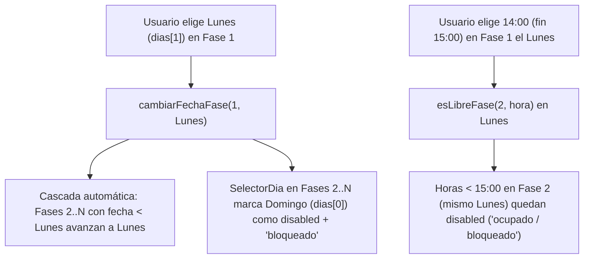

# Etapa 6 — Bloqueo cronológico preventivo en torneos (`torneo-immplementation`)

Aprobado por Miguel Medina el 31-10-2026 (rama torneo-immplementation, PR #2).

## 1. Qué se pidió y qué hay hoy

### Qué se pidió

Al programar las distintas fases de un torneo multi-día (*Octavos de final*, *Cuartos de final*, *Semifinal*, *Final*), si el usuario elige un día para una fase (por ejemplo, el **lunes** para la primera fase), el sistema **no debe permitir elegir un día anterior** (como el **domingo** previo al lunes) en las fases siguientes. En lugar de dejar que el usuario haga clic y mostrarle después un `callout alert` de error, el sistema debe **marcar como bloqueados y deshabilitar (`disabled`)** esos días (y las horas previas en el mismo día) para que el usuario no tenga la posibilidad de caer en ese error.

### Qué hay hoy (con rutas)

- `src/components/shared/SelectorDia.jsx` y `src/components/shared/SelectorDia.css`:
  - Renderiza los 7 botones de la ventana de días (`dias`), pero ninguno acepta estado deshabilitado (`disabled`) ni indicador visual de `"bloqueado"`.
- `src/components/reservas/useReserva.js`:
  - `cambiarFechaFase(ronda, iso)` (líneas 285–299) solo cambia la fecha de la ronda seleccionada (`numRonda`). Si la Fase 1 estaba en domingo (`dias[0]`) y pasa a lunes (`dias[1]`), las Fases 2 y 3 permanecen en domingo (`dias[0]`).
  - `esLibreFase(ronda, hora)` (líneas 182–217) solo verifica disponibilidad en canchas y solapamiento exacto de hora/cancha, pero permite seleccionar en el mismo día una hora **anterior** al término de la fase previa.
- `src/components/reservas/torneo/CalendarioTorneo.jsx`:
  - Pasa `dias`, `valor`, `onChange` y `contarLibres` a `<SelectorDia />`, sin filtro de bloqueo cronológico por fase, mostrando un `<div className="callout alert calendario-torneo__alerta-orden">` recién cuando el usuario ya cometió el error.
- `src/components/reservas/Torneo.test.jsx`:
  - El test 3 (`Validación de orden cronológico entre fases`, líneas 221–260) hace clic en un día anterior en *Semifinal* esperando que el botón sea clicable y aparezca el alert.



---

## 2. Decisiones y su porqué

1. **Bloqueo proactivo de días anteriores (`esDiaBloqueadoFase`)**:
   - Para toda fase $r > 1$, se calcula `fechaMinima` como el máximo `jornadas[p].fecha` de todas las fases anteriores $1 \le p < r$. Cualquier día `iso < fechaMinima` se marca como `disabled` en `SelectorDia` con la clase `.selector-dia__opcion--bloqueado` y el texto `"bloqueado"`.
   - **Por qué**: Aplica la Heurística #5 de Nielsen (*Prevención de errores*) y la guía `forms` de `modern-web-guidance` (comunicar el estado con texto además del color y deshabilitar opciones imposibles en selectores de fecha).
2. **Bloqueo del mismo día cuando la fase previa agota el horario**:
   - Si en `fechaMinima` una fase previa $p < r$ ya tiene horas seleccionadas cuya hora de finalización (`finDeFranja(ultimaHoraPrevia)`) no deja suficientes horas posteriores en `horasBase` para cubrir `faseActual.horasMinimas` (por ejemplo, si la fase previa termina a las `22:00`, última hora del día), ese día `fechaMinima` también se bloquea para la fase $r$ (y la fase $r$ avanza al día siguiente disponible si existe).
3. **Avance automático en cascada (`cambiarFechaFase` y `elegirHoraFase`)**:
   - Si el usuario adelanta la Fase 1 al lunes (`dias[1]`), cualquier fase posterior $r > 1$ que estuviera en un día anterior (`fecha < iso`) se actualiza automáticamente a `iso` (reiniciando sus `horas` si cambió de día o si sus horas en el mismo día quedaron antes del fin de la fase previa).
   - **Por qué**: Evita que una fase posterior quede seleccionada en un día que acaba de pasar a estar bloqueado.
4. **Bloqueo de horas previas en el mismo día (`esLibreFase`)**:
   - Si la fase $r > 1$ está en el mismo día que una fase previa $p < r$ y dicha fase previa tiene horas seleccionadas que terminan en `horaFinPrevia`, todas las horas `hora < horaFinPrevia` devuelven `false` en `esLibreFase(r, hora)`.
   - **Por qué**: Impide que, compartiendo el mismo lunes, el usuario elija las `14:00` para la Semifinal cuando los Cuartos terminan a las `15:00`.
5. **Conservación de `validarJornadas` en `src/lib/torneo.js`**:
   - La función pura `validarJornadas` y sus pruebas unitarias en `src/lib/torneo.test.js` se mantienen intactas como defensa en profundidad del dominio.

---

## 3. Cambios Propuestos por Archivo

### Bloque `b1-bloqueo-cronologico-fases`

#### `src/components/shared/SelectorDia.jsx`
- Añadir la prop opcional `esDiaBloqueado` (`(iso: string) => boolean`).
- Deshabilitar el botón cuando `bloqueado` sea `true`, añadir clase `selector-dia__opcion--bloqueado` y mostrar `'bloqueado'` en `.selector-dia__libres`.

```diff
-function SelectorDia({ dias, valor, onChange, contarLibres }) {
+function SelectorDia({ dias, valor, onChange, contarLibres, esDiaBloqueado }) {
   return (
     <div className="selector-dia" role="group" aria-label="Elige el día">
       {dias.map((iso) => {
         const d = aDate(iso);
         const sel = valor === iso;
+        const bloqueado = esDiaBloqueado ? Boolean(esDiaBloqueado(iso)) : false;
         const libres = contarLibres ? contarLibres(iso) : null;
         const lleno = libres === 0;
         return (
           <button
             key={iso}
             type="button"
+            disabled={bloqueado}
             className={
               'selector-dia__opcion' +
               (sel ? ' selector-dia__opcion--sel' : '') +
-              (lleno ? ' selector-dia__opcion--lleno' : '')
+              (lleno ? ' selector-dia__opcion--lleno' : '') +
+              (bloqueado ? ' selector-dia__opcion--bloqueado' : '')
             }
             aria-pressed={sel}
-            onClick={() => onChange(iso)}
+            onClick={() => !bloqueado && onChange(iso)}
           >
             <span className="selector-dia__sem">{etiquetaDia(iso, dias)}</span>
             <span className="selector-dia__num">{d.getDate()}</span>
             <span className="selector-dia__mes">{MES_CORTO[d.getMonth()]}</span>
-            {libres != null && (
+            {(bloqueado || libres != null) && (
               <span className="selector-dia__libres">
-                {lleno ? 'completo' : `${libres} libres`}
+                {bloqueado ? 'bloqueado' : lleno ? 'completo' : `${libres} libres`}
               </span>
             )}
           </button>
         );
       })}
     </div>
   );
 }
```

#### `src/components/shared/SelectorDia.css`
- Añadir estilos para `.selector-dia__opcion--bloqueado` y `:disabled`:

```css
.selector-dia__opcion--bloqueado,
.selector-dia__opcion:disabled {
  opacity: 0.42;
  cursor: not-allowed;
  background: #f1f5f9;
  border-color: #cbd5e1;
  border-style: dashed;
  color: #64748b;
  transform: none;
  box-shadow: none;
}

.selector-dia__opcion--bloqueado:hover,
.selector-dia__opcion:disabled:hover {
  border-color: #cbd5e1;
  transform: none;
  box-shadow: none;
}
```

#### `src/components/reservas/useReserva.js`
1. En `esLibreFase(ronda, hora)`:
   - Además de comprobar disponibilidad en canchas y solapamiento de canchas con otras rondas, verificar que para toda ronda previa `otraRonda < numRonda` que tenga `jOtra.fecha === fechaFase` y `jOtra.horas.length > 0`, se cumpla `hora >= finDeFranja(jOtra.horas[jOtra.horas.length - 1])`. Si `hora < horaFinPrevia`, retornar `false`.
2. Añadir `esDiaBloqueadoFase(ronda)`:
   - Para `numRonda <= 1`, retorna `() => false`.
   - Para `numRonda > 1`, determina `fechaMinima` (la mayor `jornadas[r]?.fecha` para `1 <= r < numRonda`).
   - Retorna `(iso) => iso < fechaMinima || (iso === fechaMinima && sinHorasPosterioresEnMismoDia)`.
3. En `cambiarFechaFase(ronda, iso)` y `elegirHoraFase(ronda, hora)`:
   - Propagar en cascada a las fases posteriores `r > numRonda` para que ninguna fase posterior quede en una fecha `< fechaDeFasePrevia` ni con horas seleccionadas que empiecen antes del `horaFin` de una fase previa en el mismo día.
4. Exponer `esDiaBloqueadoFase` en el objeto retornado por `useReserva`.

#### `src/components/reservas/torneo/CalendarioTorneo.jsx` y `src/components/reservas/FormularioReserva.jsx`
- Recibir `esDiaBloqueadoFase` en `CalendarioTorneo` desde `FormularioReserva` y pasarlo a `<SelectorDia esDiaBloqueado={esDiaBloqueadoFase ? esDiaBloqueadoFase(fase.ronda) : undefined} />`.

#### `src/components/reservas/Torneo.test.jsx`
- Actualizar el test 3 (`3. Validación de orden cronológico entre fases (AC-010, AC-011, FR-011)`) para comprobar que:
  - Cuando *Cuartos de final* elige el tercer día (`dias[2]`), los botones de los días anteriores (`dias[0]` y `dias[1]`) en *Semifinal* y *Final* quedan `disabled` y etiquetados con `"bloqueado"`, y la selección de *Semifinal* y *Final* avanza automáticamente a `dias[2]`.
  - Cuando *Cuartos de final* elige las `14:00` en `dias[2]`, en *Semifinal* (mismo `dias[2]`) el botón `Semifinal 14:00` (y las horas anteriores) queda `disabled`, mientras que `Semifinal 15:00` está habilitado y permite programar la Semifinal sin errores.

---

## 4. Bloques, Verificación y Commits (`planificacion-por-etapas`)

### Tabla de bloques de la Etapa 6
| ID | Bloque | Responsable | Rutas permitidas | Ola |
|---|---|---|---|---|
| `b1` | `b1-bloqueo-cronologico-fases` | Miguel Medina / agy | `src/components/shared/SelectorDia.{jsx,css}`, `src/components/reservas/useReserva.js`, `src/components/reservas/torneo/CalendarioTorneo.jsx`, `src/components/reservas/FormularioReserva.jsx`, `src/components/reservas/Torneo.test.jsx` | Ola 1 |

### Verificación
1. `npx vitest run src/lib/torneo.test.js src/components/reservas/Torneo.test.jsx`
2. `npx vitest run` (todas las suites en verde)
3. `npm run lint` (0 errores y 0 warnings)
4. `npm run build` (build de producción limpio)

### Commits previstos en `torneo-immplementation` (`commits-atomicos`)
1. `feat: bloquea días y horarios cronológicamente inválidos entre fases del torneo`
2. `test: verifica bloqueo preventivo de fechas y horas en programación de torneos`
3. `docs: registra etapa 6 de bloqueo cronológico de torneos en planificación`
